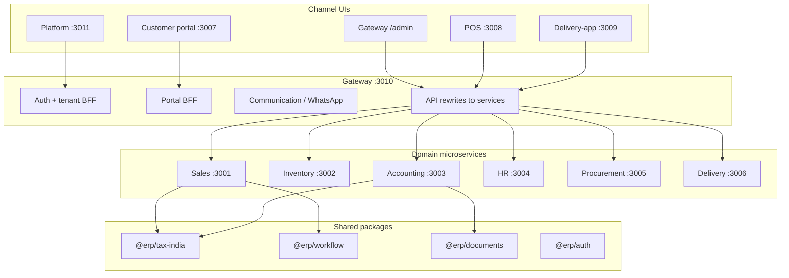

# Sankalp Application — Product Maturity & Test Coverage Assessment

**Last updated:** 2026-08-15 (BL-044 SE visual lock + BL-042 trend chips promoted)  
**Purpose:** Canonical **as-is** product state (implemented + tested), not roadmap.  
**Maintained by:** Agents must update per [`.cursor/rules/maturity-assessment.mdc`](../.cursor/rules/maturity-assessment.mdc).

**Planned work (not yet shipped):** [PRODUCT-BACKLOG.md](PRODUCT-BACKLOG.md)  
**Related checklists:** [TENANT-GST-CHECKLIST.md](TENANT-GST-CHECKLIST.md) · [AR-WORKBENCH-CHECKLIST.md](AR-WORKBENCH-CHECKLIST.md) · [REMEDIATION-CHECKLIST.md](REMEDIATION-CHECKLIST.md)

**Method:** Read-only inspection of monorepo (`/home/erp`), 11 apps, 20 packages, 31 unit test files, 6 TypeScript E2E scripts + 1 bash E2E.  
**Rule applied:** Documented ≠ Implemented ≠ Tested. Scores capped when tests or production integrations are missing.

---

## 1. Executive Summary

Sankalp is a **multi-tenant microservices ERP** with a **Gateway admin shell**, headless domain services (sales, inventory, accounting, procurement, HR, delivery), and channel apps (customer portal, POS, delivery-app, platform console). The **Order-to-Cash spine is real and E2E-validated** on greenfield tenants; **GST is a tenant tax pack** with strong Phase A coverage; **NIC/e-way remain sandbox stubs**.

| Metric | Score | Basis |
|--------|-------|-------|
| **Overall Product Maturity** | **6.8 / 10** (3.4 / 5 weighted) | Weighted module average (see §8) |
| **Order-to-Cash Maturity** | **7.3 / 10** (3.7 / 5 weighted) | Primary business path (see §7) |
| **Automated Test Coverage** | **UNKNOWN %** | 25 unit files + 6 E2E scripts; E2E gated by [`e2e-api.yml`](.github/workflows/e2e-api.yml) / `pnpm ci:e2e`; no global coverage tool |

**Current position**

- **Strong:** Multi-tenant OMS workflow (SREQ→SO→prep→dispatch→deliver→invoice→payment), Order Desk UI, Process Studio (forms/workflows/documents), catalog/stock APIs, tenant GST pack + Quick Bill, greenfield security/isolation E2E (175/175), GST E2E (39/39), **local CI E2E gate green** (greenfield+gst+portal+saas+capture).
- **Usable today:** Dealer order desk (phone operational mode), walk-in SO + Quick Bill, CRM Lead-to-Cash convert, commercial + tax invoices, manual payment recording, AR ageing/credit check, GSTR-1 export, sales returns + credit notes (API/UI), procurement PO flow, analytics/reconciliation panels.
- **Incomplete:** Production NIC IRP, QR on PDF, e-way auto-trigger, online payments (Razorpay), multi-invoice allocation, broad route auth test matrix, idempotency contract tests.
- **Risky:** WhatsApp requires live Fast2SMS credentials; `@erp/workflow` engine package still documents stubs though Sales runs v5 runtime in [`apps/sales/src/lib/workflow-runtime-v5.ts`](apps/sales/src/lib/workflow-runtime-v5.ts). First remote GitHub Actions green depends on next push to `main`/PR.

**Recommended Top 5 Priorities**

1. **P0** — Production payment collection (Razorpay/UPI) + multi-invoice allocation on same `Invoice` ([`docs/AR-WORKBENCH-CHECKLIST.md`](docs/AR-WORKBENCH-CHECKLIST.md)).
2. **P1** — Production NIC IRP credentials + QR embedding on tax invoice PDF ([`docs/TENANT-GST-CHECKLIST.md`](docs/TENANT-GST-CHECKLIST.md) Phase B).
3. **P1** — Route-level auth + idempotency contract tests per [`docs/REMEDIATION-CHECKLIST.md`](docs/REMEDIATION-CHECKLIST.md) Tier 1.
4. **P1** — E-way auto-trigger from dispatch workflow + U4 (REQUIRED IRN blocks ISSUED) E2E validation.
5. **P2** — Sales returns E2E + mandatory audit events.

---

## 2. Application Architecture Understanding



- **11 apps** under [`apps/`](apps/); 6 headless API services + 5 UIs (per explore agent).
- **Per-service PostgreSQL** via Prisma (tenantId on all domain rows).
- **Gateway** = auth, tenant admin, portal BFF, WhatsApp, notifications, 90+ rewrite rules ([`apps/gateway/next.config.ts`](apps/gateway/next.config.ts)).
- **Workflow execution** lives in Sales (`workflow-runtime-v5`), not the generic `@erp/workflow` engine ([`packages/workflow/src/engine/index.ts`](packages/workflow/src/engine/index.ts) = stub types only).

---

## 3. Master Module / Feature Matrix

| Module | Feature | Use Case Coverage | Maturity | Test Coverage | Assumption | Gaps | Limitations | Evidence |
|--------|---------|-------------------|----------|---------------|------------|------|-------------|----------|
| **Platform/SaaS** | Tenant provisioning | U1 create tenant FULL; U2 license modules FULL; U3 capabilities FULL | **4** | Unit: PARTIAL (permissions); Integration: NO; E2E: YES (greenfield); Regression: NO | Single platform operator creds | No self-service signup | Platform operator only, not tenant self-provision | [`apps/platform/src/app/tenants/`](apps/platform/src/app/tenants/), [`scripts/e2e-greenfield.ts`](scripts/e2e-greenfield.ts) |
| Platform | Tenant settings & tax profile | U1 tax.regime NONE FULL; U2 IN_GST FULL; U3 invalid combo rejected FULL | **4** | Unit: YES (settings route.test); E2E: YES (gst) | One tax profile per tenant | No multi-GSTIN per tenant | One GSTIN per tenant by design | [`apps/gateway/src/app/(admin)/administration/tax-invoicing-panel.tsx`](apps/gateway/src/app/(admin)/administration/tax-invoicing-panel.tsx), [`packages/tax-india/src/profile.ts`](packages/tax-india/src/profile.ts) |
| Platform | Module licensing / nav gating | U1 role-based nav FULL; U2 module disable PARTIAL; U3 plan-feature intersect FULL | **4** | Unit: YES (nav-access.test); E2E: YES (greenfield security, saas Free hides OMS) | Role ∩ plan features | Fine-grained permission matrix incomplete | Not all routes enforce permissions yet | [`apps/gateway/src/lib/nav-access.ts`](apps/gateway/src/lib/nav-access.ts) |
| Platform | Audit log | U1 list audit PARTIAL; U2 mandatory events NOT_SUPPORTED | **2** | Unit: YES (audit route.test); E2E: NO | Admin-only read | Mandatory audit events for finance/stock not enforced | Retention/filter policy incomplete | [`apps/gateway/src/app/api/audit/route.ts`](apps/gateway/src/app/api/audit/route.ts), [`docs/REMEDIATION-CHECKLIST.md`](docs/REMEDIATION-CHECKLIST.md) |
| Platform | License billing (SaaS) | U1 new tenant Free FULL; U2 upgrade OPEN then PAID FULL; U3 duplicate pay no-op FULL; U4 Starter feature/seat gates FULL; U5 lead-window renewal invoice FULL; U6 grace downgradeToFree FULL; U7 ONCE perpetual FULL; U8 LIVE Checkout PARTIAL; U9 platform create plan FULL | **4** | Unit: YES (entitlement + nav intersect + periodLengthDays); E2E: YES (saas 25/25) | DEMO default; no-row = Free features (not `*`); ACTIVE paid snapshot only after BillingInvoice PAID; catalog edits do not mutate in-period snapshots | LIVE Order+Checkout not E2E; no email dunning | Not dealer AR / Route (BL-002); Razorpay is PaymentProvider adapter only | [`apps/gateway/src/lib/billing-core.ts`](apps/gateway/src/lib/billing-core.ts), [`apps/platform/src/app/billing/page.tsx`](../apps/platform/src/app/billing/page.tsx), [`scripts/e2e-saas-billing.ts`](scripts/e2e-saas-billing.ts), [`docs/E2E-SAAS-BILLING-latest.md`](E2E-SAAS-BILLING-latest.md) |
| Platform | Design System v2 | U1 `@erp/ui` tokens/shell/primitives FULL; U2 Gateway+Platform PageScaffold FULL; U3 Customer/Delivery/POS consume tokens FULL | **4** | E2E: YES (portal 20/20, saas 25/25); Live smoke: YES (admin spine + platform billing) | Forest brand + amber accent; `PageHeader` deprecated | No visual regression suite | Not a second brand/theme | [`packages/ui/src/tokens/tokens.css`](../packages/ui/src/tokens/tokens.css), [`docs/guides/design-system.md`](guides/design-system.md), [`apps/gateway/src/app/(admin)/`](../apps/gateway/src/app/(admin)/), [`apps/customer/`](../apps/customer/), [`apps/pos/`](../apps/pos/), [`apps/delivery-app/`](../apps/delivery-app/) |
| Platform | Admin operational cockpit | U1 TODAY attention hide-zeros FULL; U2 collect/overdue-receivables hero FULL; U3 saved Customize never auto-replaced FULL; U4 phone presentation order FULL; U5 curated role sample layouts FULL; U6 chart click → Desk/AR FULL; U7 My Tasks + pipeline status bars FULL; U8 SE visual lock (hero/greeting/attention) FULL; U9 three-state My Tasks viz FULL; U10 sales trend range chips FULL | **4** | Unit: YES (`defaults`, `charts/hrefs` incl. `taskVizMode`/`revenueTrendRangeBounds`, `presentation`); E2E: YES (greenfield 187/187) | Density-aware viz; Sales layout trend\|customers; compact sales KPIs; session-only range chips | Phase C brush/zoom; global date chrome | Not a BI platform; adapts viz to data density | [`defaults.ts`](../packages/ui/src/dashboard/defaults.ts), [`charts/hrefs.ts`](../packages/ui/src/dashboard/charts/hrefs.ts), [`ops-role.tsx`](../packages/ui/src/dashboard/widgets/ops-role.tsx), [`revenue-trend.tsx`](../packages/ui/src/dashboard/widgets/revenue-trend.tsx), [`dashboard/page.tsx`](../apps/gateway/src/app/(admin)/dashboard/page.tsx), [`scripts/e2e-greenfield.ts`](../scripts/e2e-greenfield.ts) |
| Platform | Admin mobile operational mode (MA3) | U1 phone density FULL; U2 hide Process Studio FULL; U3 Bill & Collect phone read-only FULL; U4 desk Needs action / Next glance FULL; U5 desktop dense unchanged FULL; U6 phone dashboard Hero→CTA→Tasks→TODAY FULL | **4** | Unit: YES (`presentation`); Manual: YES; E2E: YES (greenfield 175/175) | `data-admin-mode=operational` &lt;768px; TODAY 2×2; Customize under ⋮; Button `--ink-inverse` | Capacitor / native shell; Order Desk claim cards (BL-040) | Phone = glance + claim; studios stay tablet+ | [`packages/ui/src/shell/AdminShell.tsx`](../packages/ui/src/shell/AdminShell.tsx), [`presentation.ts`](../packages/ui/src/dashboard/presentation.ts), [`ops-role.tsx`](../packages/ui/src/dashboard/widgets/ops-role.tsx), [`SalesDeskWorkspace.tsx`](../apps/gateway/src/app/(admin)/sales-desk/SalesDeskWorkspace.tsx), [`SANKALP-UI-UX-ROADMAP.md`](SANKALP-UI-UX-ROADMAP.md) §6.14 |
| Platform | E2E CI gate | U1 greenfield FULL; U2 gst FULL; U3 portal FULL; U4 saas FULL; U5 capture FULL | **4** | Local `pnpm ci:e2e` YES (2026-08-15): 175+39+20+25+24 | Serial Docker builds; OTEL opaque loader | Remote GHA green on next push | Blocks merge via `e2e-api.yml` | [`.github/workflows/e2e-api.yml`](../.github/workflows/e2e-api.yml), [`scripts/ci-e2e.sh`](../scripts/ci-e2e.sh) |
| **Auth/Security** | JWT login (staff/customer/platform) | U1 staff login FULL; U2 buyer login FULL; U3 wrong tenant PARTIAL | **4** | Unit: YES (auth middleware); E2E: YES | Email/password primary | OAuth not implemented | Phone OTP partial | [`apps/gateway/src/app/api/auth/route.ts`](apps/gateway/src/app/api/auth/route.ts) |
| Auth | Tenant isolation | U1 cross-tenant read denied FULL; U2 cross-tenant write denied PARTIAL | **4** | E2E: YES (greenfield, gst); Unit: PARTIAL (4 gateway routes) | x-tenant-id header trusted from gateway | Not all service routes have wrong-tenant tests | Service-to-service trust model | [`scripts/e2e-gst-tenants.ts`](scripts/e2e-gst-tenants.ts) isolation section |
| Auth | RBAC / permissions | U1 coarse roles FULL; U2 custom roles PARTIAL; U3 fine-grained NOT_SUPPORTED | **3** | Unit: PARTIAL | Workflow task auth per activity | Full permission matrix adoption open | Branch-scoped access not enforced | [`packages/platform-core/src/permissions.test.ts`](packages/platform-core/src/permissions.test.ts) |
| **Sales/CRM** | Customer master | U1 CRUD FULL; U2 GSTIN validate FULL; U3 B2C no GSTIN FULL; U4 wallet/addresses PARTIAL | **4** | Unit: NO; E2E: YES (gst, greenfield) | Manual GSTIN entry | No GSTN verification API | One taxId per customer | [`apps/sales/src/app/api/customers/route.ts`](apps/sales/src/app/api/customers/route.ts) |
| Sales | Sales Request (SREQ) | U1 staff create FULL; U2 portal checkout FULL; U3 OPEN→CONVERT FULL; U4 checkout note+attachments → SO FULL | **4** | E2E: YES (portal 20/20, greenfield 175) | Catalog groups seeded; buyer attach before convert | — | — | [`apps/customer/src/app/(app)/checkout/page.tsx`](apps/customer/src/app/(app)/checkout/page.tsx), [`apps/sales/src/app/api/sales-requests/[id]/documents/route.ts`](apps/sales/src/app/api/sales-requests/[id]/documents/route.ts), [`docs/E2E-GREENFIELD-latest.md`](docs/E2E-GREENFIELD-latest.md) |
| Sales | SREQ → SO conversion | U1 convert FULL; U2 credit block FULL; U3 workflow snapshot FULL; U4 note/docs copy FULL | **4** | E2E: YES | Canonical `createConfirmedSalesOrder`; credit limit only when >0; `OrderNote`/`OrderDocument` from checkout | No partial convert | — | [`apps/sales/src/lib/create-confirmed-sales-order.ts`](apps/sales/src/lib/create-confirmed-sales-order.ts), [`apps/sales/src/app/api/sales-requests/[id]/convert/route.ts`](apps/sales/src/app/api/sales-requests/[id]/convert/route.ts) |
| Sales | Sales Order + workflow v5 | U1 task sequence FULL; U2 role claim/complete FULL; U3 custom template PARTIAL | **4** | E2E: YES (165 greenfield); Unit: PARTIAL (workflow validator) | SO_STANDARD template published | Generic workflow engine package stub | Workflow runtime Sales-specific | [`apps/sales/src/lib/workflow-runtime-v5.ts`](apps/sales/src/lib/workflow-runtime-v5.ts), [`apps/sales/src/workflow-templates/so-standard-v5.ts`](apps/sales/src/workflow-templates/so-standard-v5.ts) |
| Sales | Order Desk UI | U1 inbox queue FULL; U2 task completion FULL; U3 journey tracking FULL; U4 walk-in create FULL; U5 Work Item labels FULL; U6 phone glance queue FULL | **4** | E2E: YES (greenfield 175 + capture 24/24) + Manual | Work Items (Confirm Order … Bill & Collect) not 1:1 activities; PageScaffold chrome; MA3 phone cards | No bulk dispatch | — | [`apps/gateway/src/app/(admin)/sales-desk/SalesDeskWorkspace.tsx`](apps/gateway/src/app/(admin)/sales-desk/SalesDeskWorkspace.tsx), [`packages/workflow/src/work-items/so-standard.ts`](packages/workflow/src/work-items/so-standard.ts) |
| Sales | Walk-in SO (fulfilment) | U1 existing or walk-in customer FULL; U2 CONFIRMED + SO_STANDARD FULL; U3 exclusive sourceKind FULL | **4** | E2E: YES (`e2e:capture`) | Same `createConfirmedSalesOrder` as SREQ/Quote | No client idempotency key | Not Quick Bill | [`apps/sales/src/lib/create-confirmed-sales-order.ts`](apps/sales/src/lib/create-confirmed-sales-order.ts), [`scripts/e2e-capture-channels.ts`](scripts/e2e-capture-channels.ts) |
| Sales | Quick Bill | U1 walk-in bill FULL; U2 same Invoice entity FULL; U3 GST/non-GST FULL | **4** | E2E: YES (39 gst) | CASH default | No barcode scanner UI | Bypasses SREQ intentionally; no SO_STANDARD | [`apps/sales/src/app/api/quick-bills/route.ts`](apps/sales/src/app/api/quick-bills/route.ts), [`apps/gateway/src/app/(admin)/quick-bill/page.tsx`](apps/gateway/src/app/(admin)/quick-bill/page.tsx) |
| Sales | CRM Lead-to-Cash | U1 Lead→Opportunity FULL; U2 Opportunity→Quote FULL; U3 ACCEPTED Quote→SO FULL; U4 convert idempotent FULL | **4** | E2E: YES (`e2e:capture` 24/24) | Canonical SO builder; ACCEPTED only | Quote send/PDF not in scope | Not a second OMS | [`apps/sales/src/app/api/quotes/[id]/convert/route.ts`](apps/sales/src/app/api/quotes/[id]/convert/route.ts), [`docs/guides/sales-channels.md`](guides/sales-channels.md) |
| Sales | Sales returns | U1 create FULL; U2 approve/complete FULL; U3 restock+credit note FULL | **3** | E2E: NO | Return against shipped order | No dedicated returns E2E | — | [`apps/sales/src/app/api/returns/[id]/route.ts`](apps/sales/src/app/api/returns/[id]/route.ts), [`apps/gateway/src/app/(admin)/returns/page.tsx`](apps/gateway/src/app/(admin)/returns/page.tsx) |
| **Inventory** | Product catalog | U1 CRUD FULL; U2 variants FULL; U3 attributes FULL; U4 import PARTIAL | **4** | E2E: YES (greenfield catalog) | HSN on product for GST | Bulk import edge cases | — | [`apps/gateway/src/app/(admin)/products/page.tsx`](apps/gateway/src/app/(admin)/products/page.tsx) |
| Inventory | Stock (reserve/release/deduct/transfer) | U1 receive FULL; U2 reserve at checkout PARTIAL; U3 deduct on dispatch FULL | **4** | E2E: YES (greenfield invariants) | Stock before dispatch | Idempotency tests missing | — | [`apps/inventory/src/app/api/stock/`](apps/inventory/src/app/api/stock/) |
| Inventory | Price lists & quoting | U1 price list CRUD FULL; U2 portal quote FULL | **4** | Unit: YES (pricing quote.test) | One active list per context | Customer-specific pricing partial | — | [`packages/pricing/src/quote.test.ts`](packages/pricing/src/quote.test.ts) |
| Inventory | Catalog groups (portal) | U1 group resolve FULL; U2 seed idempotent FULL | **4** | E2E: YES (portal 20/20) | Demo seed completeness | — | — | [`scripts/seed-client-demo.ts`](scripts/seed-client-demo.ts), [`docs/E2E-REPORT-latest.md`](docs/E2E-REPORT-latest.md) |
| **Fulfilment** | Preparation / warehouse-ready | U1 workflow task FULL; U2 stock verify FULL | **4** | E2E: YES | Sequential prep steps | — | — | greenfield Phase 5–6 |
| Fulfilment | Dispatch | U1 own fleet FULL; U2 Porter link FULL; U3 e-way auto NOT_SUPPORTED | **3** | E2E: YES | Manual dispatch form | No e-way auto-trigger | Porter = external tab only | [`apps/gateway/src/app/(admin)/administration/porter-logistics-panel.tsx`](apps/gateway/src/app/(admin)/administration/porter-logistics-panel.tsx) |
| Fulfilment | Delivery confirmation | U1 deliver-oms task FULL; U2 delivery-app PARTIAL | **3** | E2E: YES (greenfield) | Delivery exec role | Delivery FSM tests missing | — | [`apps/delivery/src/app/api/assignments/`](apps/delivery/src/app/api/assignments/) |
| **Accounting** | Invoice generation | U1 from SO FULL; U2 once per order FULL; U3 PDF FULL | **4** | E2E: YES | Workflow triggers invoice task; `seller.logoUrl` from tenant `brand.logo` | PDF engine quality (BL-025) | — | [`apps/accounting/src/lib/generate-invoice.ts`](apps/accounting/src/lib/generate-invoice.ts) |
| Accounting | GST tax calculation | U1 NONE/commercial FULL; U2 B2B/B2C FULL; U3 composition FULL; U4 mixed lines PARTIAL; U5 snapshot immutability FULL | **4** | Unit: YES (7 tests); E2E: YES (39) | Product has HSN/rate | U4 E2E not full | U7 unit only | [`packages/tax-india/src/tax-calc.test.ts`](packages/tax-india/src/tax-calc.test.ts) |
| Accounting | E-invoice (IRN) | U1 OPTIONAL manual FULL; U2 cancel FULL; U3 REQUIRED block PARTIAL; U4 production NOT_SUPPORTED | **2** | E2E: YES (sandbox); Unit: NO | DEMO stub mode | Real NIC API; QR on PDF | Sankalp not IRP host | [`apps/accounting/src/lib/nic-einvoice.ts`](apps/accounting/src/lib/nic-einvoice.ts) |
| Accounting | E-way bill | U1 manual sandbox FULL; U2 cancel FULL; U3 commercial reject FULL; U4 dispatch auto NOT_SUPPORTED | **2** | E2E: YES (sandbox) | Manual API call | Auto from dispatch | Sandbox only | [`apps/accounting/src/app/api/invoices/[id]/eway/route.ts`](apps/accounting/src/app/api/invoices/[id]/eway/route.ts) |
| Accounting | GSTR-1 export | U1 JSON/CSV FULL; U2 exclude non-GST FULL | **3** | E2E: YES | Export for CA/tools | No GSTN push | Intentionally not filing platform | [`apps/accounting/src/app/api/invoices/gstr1-export/route.ts`](apps/accounting/src/app/api/invoices/gstr1-export/route.ts) |
| Accounting | Payment recording | U1 manual on invoice FULL; U2 partial PARTIAL; U3 idempotent retry PARTIAL | **3** | E2E: YES (greenfield) | Payment on existing invoice | No Razorpay webhook | Online pay out of scope today | [`apps/accounting/src/app/api/invoices/[id]/route.ts`](apps/accounting/src/app/api/invoices/[id]/route.ts) |
| Accounting | Credit/debit notes | U1 API FULL; U2 apply from return FULL; U3 UI PARTIAL | **3** | E2E: NO | Linked to invoice/return | Limited UI workflow | — | [`apps/accounting/src/app/api/credit-notes/route.ts`](apps/accounting/src/app/api/credit-notes/route.ts) |
| Accounting | AP bills & journals | U1 CRUD FULL; U2 balanced journals FULL; U3 payroll post fail-closed FULL | **3** | Unit: PARTIAL (reconciliation) | Accountant role | Broad AP E2E missing | — | [`docs/REMEDIATION-CHECKLIST.md`](docs/REMEDIATION-CHECKLIST.md) Phase 1 |
| Accounting | Reconciliation analytics | U1 invoice vs payment FULL; U2 date guards FULL | **3** | Unit: YES; E2E: NO | — | — | — | [`apps/accounting/src/app/api/reports/reconciliation/route.test.ts`](apps/accounting/src/app/api/reports/reconciliation/route.test.ts) |
| Accounting | POS shifts/bills | U1 shift open FULL; U2 bill create FULL | **3** | E2E: NO | Cashier userId | Separate from OMS Invoice path | Platform track per remediation doc | [`apps/pos/src/app/(app)/billing/page.tsx`](apps/pos/src/app/(app)/billing/page.tsx) |
| **AR** | Ageing analysis | U1 buckets FULL; U2 outstanding FULL | **3** | E2E: NO | Same Invoice entity | No scheduled overdue job | — | [`apps/accounting/src/app/api/ar/ageing/route.ts`](apps/accounting/src/app/api/ar/ageing/route.ts) |
| AR | Credit check / block | U1 on convert FULL; U2 on Quick Bill FULL | **3** | E2E: NO (gst doesn't test block) | creditLimit > 0 only | — | — | [`apps/accounting/src/app/api/ar/credit-check/route.ts`](apps/accounting/src/app/api/ar/credit-check/route.ts) |
| AR | Receivables UI | U1 ageing cards FULL; U2 record payment FULL | **3** | E2E: NO | Admin UI | Collection queue missing | — | [`apps/gateway/src/app/(admin)/ar/page.tsx`](apps/gateway/src/app/(admin)/ar/page.tsx) |
| **Procurement** | Vendor master | U1 CRUD FULL; U2 authz FULL | **3** | E2E: YES (e2e-user-flows.sh) | — | — | — | [`scripts/e2e-user-flows.sh`](scripts/e2e-user-flows.sh) |
| Procurement | Purchase orders | U1 create/submit FULL; U2 approve auth FULL | **3** | E2E: YES (bash) | Manager approval | Receiving E2E not in TS suite | — | [`apps/gateway/src/app/(admin)/purchase-orders/page.tsx`](apps/gateway/src/app/(admin)/purchase-orders/page.tsx) |
| Procurement | GRN / receiving | U1 API FULL; U2 accounting post PARTIAL | **3** | E2E: NO | Retry-safe per remediation | Contract tests open | — | remediation Phase 1 checked |
| **HR** | Employees | U1 CRUD FULL; U2 delivery executive link PARTIAL | **2** | E2E: NO | Platform track | Limited UI depth | Excluded from Trustwood GA scope | [`apps/gateway/src/app/(admin)/employees/page.tsx`](apps/gateway/src/app/(admin)/employees/page.tsx) |
| HR | Payroll | U1 process FULL; U2 fail-closed on accounting FULL | **2** | E2E: NO | Simple tax slab | No payslip E2E | Roadmap / platform | [`apps/hr/src/app/api/payroll/route.ts`](apps/hr/src/app/api/payroll/route.ts) |
| **Process Studio** | Workflow designer | U1 canvas edit FULL; U2 publish FULL; U3 validate FULL | **4** | Unit: YES; E2E: YES (greenfield Phase 2) | Published snapshot immutable | Runtime only on Sales SO | — | [`apps/gateway/src/app/(admin)/workflows/`](apps/gateway/src/app/(admin)/workflows/) |
| Process Studio | Form designer | U1 CRUD/publish FULL; U2 ExternalLink FULL; U3 starter rev2+upgrade FULL; U4 market task copy + Porter ExternalLink on dispatch FULL | **4** | Unit: YES; E2E: YES (greenfield 169/169) | Starter rev3 dealer titles; warehouseId persist; payment method/UTR; `urlFromVariable: porterBookUrl` | DriverPicker may 403 for non-admin; POD history not durable across reload | Porter = ExternalLink helper; DispatchFulfillment keeps gates | [`so-standard-v5.ts`](apps/sales/src/workflow-templates/so-standard-v5.ts), [`sales-order-adapter.ts`](apps/sales/src/workflow-adapter/sales-order-adapter.ts), [`DEMO-WALKTHROUGH.md`](DEMO-WALKTHROUGH.md), [`E2E-GREENFIELD-latest.md`](E2E-GREENFIELD-latest.md) |
| Process Studio | Document designer | U1 templates FULL; U2 PDF render FULL; U3 print widgets FULL; U4 simulate feed FULL; U5 generic Studio chrome FULL; U6 business/power/developer chrome FULL | **4** | Unit: YES (render.test + print-widgets.test + studio.test) | Business default; Preview + PDF download; currency as Rs. (Helvetica); canvas table shows sample rows; tax/commercial/BOS seeds share modern B2B chrome (`#173f5f` header, soft party cards) | QR not in Business catalog; PDF still single-page Helvetica — ₹ is BL-025 | Widgets do not fetch APIs; `studio.*` ignored at render | [`packages/documents/src/pdf.ts`](packages/documents/src/pdf.ts), [`packages/documents/src/render.ts`](packages/documents/src/render.ts), [`packages/documents/src/seed-tax-invoice.ts`](packages/documents/src/seed-tax-invoice.ts), [`packages/document-designer/src/CanvasItem.tsx`](packages/document-designer/src/CanvasItem.tsx) |
| **Customer channel** | Portal shop/checkout | U1 browse FULL; U2 checkout FULL; U3 order tracking PARTIAL; U4 sticky phone CTAs FULL; U5 never ₹0 FULL; U6 deterministic material imagery FULL; U7 fixed vs configure cards FULL; U8 compact PDP FULL; U9 More nav FULL | **4** | E2E: YES (portal 20/20); Unit: YES (`pricing-display.test`) | `formatPortalPrice` SSOT; Outfit typography; Trustwood seed media refresh | Cart/reorder/dealer price (follow-on) | — | [`apps/customer/`](../apps/customer/), [`pricing-display.ts`](../apps/customer/src/lib/pricing-display.ts), [`media.ts`](../apps/customer/src/lib/media.ts), [`docs/E2E-REPORT-latest.md`](docs/E2E-REPORT-latest.md) |
| Customer | Inbox/messaging | U1 conversations FULL; U2 read receipts PARTIAL | **3** | E2E: NO | Gateway BFF | — | — | [`apps/gateway/src/app/api/communication/`](apps/gateway/src/app/api/communication/) |
| **Integrations** | WhatsApp (Fast2SMS) | U1 configure FULL; U2 send if creds PARTIAL; U3 webhook FULL | **3** | E2E: NO | Live API key required | Excluded from Trustwood GA | Provider lock-in Fast2SMS | [`apps/gateway/src/lib/integrations/whatsapp-integration-service.ts`](apps/gateway/src/lib/integrations/whatsapp-integration-service.ts) |
| Integrations | Notifications (in-app, FCM, email, SMS, WhatsApp outbound, Telegram) | U1 list/read FULL; U2 FCM register FULL; U3 send command v1 FULL; U4 DEMO all channels FULL; U5 LIVE SMTP/Fast2SMS/Telegram PARTIAL; U6 delivery log + retry FULL | **3** | Unit: YES (`@erp/notifications` + send route); E2E: NO | DEMO default; LIVE needs tenant connectors | LIVE WhatsApp session 24h window; DLT SMS templates | Not a microservice (ADR 0019); two-way chat is Communication | [`packages/notifications/`](../packages/notifications/), [`apps/gateway/src/lib/notifications/`](../apps/gateway/src/lib/notifications/), [`docs/adr/0019-notification-platform-capability.md`](adr/0019-notification-platform-capability.md) |
| Integrations | Online payments | NOT_SUPPORTED | **0** | NO | — | Razorpay/UPI | Deferred P0.3 | [`docs/AR-WORKBENCH-CHECKLIST.md`](docs/AR-WORKBENCH-CHECKLIST.md) |
| **Analytics** | Cross-module dashboard | U1 sales/inventory/delivery FULL; U2 reconciliation FULL | **3** | Unit: PARTIAL; E2E: NO | Panel retry independent | CSV export Tier 2 | — | [`apps/gateway/src/app/(admin)/analytics/page.tsx`](apps/gateway/src/app/(admin)/analytics/page.tsx) |

---

## 4. Module Maturity Summary

| Module | Feature Count | Avg Maturity | Test Coverage | Critical Gaps | Status |
|--------|---------------|--------------|---------------|---------------|--------|
| Platform/SaaS | 8 | 3.8 | Unit PARTIAL, E2E YES + CI gate | Audit event coverage, LIVE Checkout | **AMBER** |
| Auth/Security | 3 | 3.7 | Unit PARTIAL, E2E YES | Fine-grained RBAC, route test matrix | **AMBER** |
| Sales/CRM | 9 | 3.9 | E2E YES (core + capture) | Returns E2E | **GREEN** |
| Inventory | 4 | 3.75 | Unit+ E2E YES | Idempotency tests | **GREEN** |
| Fulfilment | 3 | 3.3 | E2E YES | E-way auto, delivery FSM tests | **AMBER** |
| Accounting/Billing | 9 | 3.1 | Unit PARTIAL, E2E YES (GST/O2C) | Production NIC, online pay | **AMBER** |
| AR/Payments | 3 | 3.0 | E2E NO | Razorpay, allocation, overdue job | **AMBER** |
| Procurement | 3 | 3.0 | E2E PARTIAL (bash) | GRN contract tests | **AMBER** |
| HR/Payroll | 2 | 2.0 | NO | Out of Trustwood GA scope | **RED** |
| Process Studio | 3 | 4.0 | Unit+ E2E YES | Generic engine stub | **GREEN** |
| Customer channel | 2 | 3.0 | E2E flaky | Seed + offline | **AMBER** |
| Integrations | 3 | 2.0 | Unit PARTIAL | Payments; LIVE channel verification | **AMBER** |
| Analytics | 1 | 3.0 | Unit PARTIAL | Export/report breadth | **AMBER** |

---

## 5. Use-Case Coverage Summary

**GST tax pack (from [`docs/TENANT-GST-CHECKLIST.md`](docs/TENANT-GST-CHECKLIST.md))**

| UC | Description | Coverage |
|----|-------------|----------|
| U1 | Non-GST tenant commercial bill | FULL (E2E) |
| U2 | GST B2B tax invoice | FULL (E2E) |
| U3 | Optional IRN manual | FULL (E2E sandbox) |
| U4 | REQUIRED IRN blocks ISSUED | PARTIAL (code path only) |
| U5 | B2C CGST+SGST | FULL (E2E) |
| U6 | Composition bill of supply | FULL (E2E) |
| U7 | Mixed exempt/taxable lines | PARTIAL (unit only) |
| U8 | NONE tenant + buyer GSTIN | FULL (E2E) |
| U9 | Quick Bill walk-in | FULL (E2E) |

**Order-to-Cash primary path**

| Step | Coverage |
|------|----------|
| Customer master | FULL |
| Order capture (SREQ/portal/walk-in SO/quote) | FULL |
| SO + workflow | FULL (greenfield) |
| Prep + stock | FULL |
| Dispatch/delivery | FULL (manual e-way) |
| Invoice + PDF | FULL |
| GST determination | FULL (stub NIC) |
| Payment collect | FULL (manual) |
| AR ageing | FULL (API/UI, untested E2E) |

---

## 6. Test Coverage Summary

**Inventory (factual)**

| Layer | Count | CI |
|-------|-------|-----|
| Unit/contract (`*.test.ts`) | 31 files | YES (`pnpm test:workspaces`) |
| Route contract tests | 6 gateway + 1 accounting | YES |
| E2E TypeScript scripts | 6 | **YES** (`e2e-api.yml` → `pnpm ci:e2e`; local green 2026-08-15) |
| E2E bash | 1 (`e2e-user-flows.sh`) | **NO** |
| Playwright/Jest/Vitest | 0 configs | — |

**E2E results (latest reports on disk)**

| Suite | Result | Evidence |
|-------|--------|----------|
| `e2e:greenfield` | 175/175 PASS | [`docs/E2E-GREENFIELD-latest.md`](docs/E2E-GREENFIELD-latest.md) |
| `e2e:gst` | 39/39 PASS | [`docs/E2E-GST-latest.md`](docs/E2E-GST-latest.md) |
| `e2e:portal` | 20/20 PASS | [`docs/E2E-REPORT-latest.md`](docs/E2E-REPORT-latest.md) |
| `e2e:saas` | 25/25 PASS | [`docs/E2E-SAAS-BILLING-latest.md`](docs/E2E-SAAS-BILLING-latest.md) |
| `e2e:capture` | 24/24 PASS | [`scripts/e2e-capture-channels.ts`](scripts/e2e-capture-channels.ts) |
| `pnpm ci:e2e` (all five) | PASS | `/tmp/ci-e2e-run.log` 2026-08-15 |
| `e2e:oms` | Documented 20/20 (older) | [`docs/E2E-TEST-RESULTS.md`](docs/E2E-TEST-RESULTS.md) |

**Feature test coverage pattern (typical)**

| Feature | Unit | Integration | API | E2E | Regression |
|---------|------|-------------|-----|-----|------------|
| OMS workflow | PARTIAL | NO | NO | YES | NO |
| GST/tax-india | YES | NO | NO | YES | NO |
| Invoice generation | NO | NO | NO | YES | NO |
| AR workbench | NO | NO | NO | NO | NO |
| Auth tenant isolation | YES | NO | YES | YES | NO |
| WhatsApp | NO | NO | NO | NO | NO |

**Test Coverage Score:** UNKNOWN — critical scenarios (~50+) identified across GST checklist + greenfield phases; automated coverage ~4 E2E suites + 23 unit files; no denominator mapping to assign a defensible percentage.

---

## 7. Order-to-Cash Maturity

| Stage | Maturity (0–5) | Weight | Weighted |
|-------|----------------|--------|----------|
| Customer master | 4.0 | 10% | 0.40 |
| Order capture | 4.0 | 10% | 0.40 |
| Sales Order | 4.0 | 15% | 0.60 |
| Order Desk | 4.0 | 10% | 0.40 |
| Fulfilment (prep) | 4.0 | 15% | 0.60 |
| Dispatch | 3.0 | 10% | 0.30 |
| Invoice | 4.0 | 15% | 0.60 |
| GST compliance layer | 3.5 | 5% | 0.18 |
| AR | 3.0 | 5% | 0.15 |
| Payment | 3.5 | 5% | 0.18 |

**Order-to-Cash score: 3.81 / 5 → 7.6 / 10** (rounded **7.3 / 10** conservatively due to missing payment gateway and AR E2E)

---

## 8. Overall Product Maturity

| Module bucket | Weight | Avg maturity | Contribution |
|---------------|--------|--------------|--------------|
| Core Order-to-Cash | 30% | 3.7 | 1.11 |
| Product/Catalog | 10% | 3.75 | 0.38 |
| Inventory/Fulfilment | 15% | 3.5 | 0.53 |
| Billing/Accounting | 15% | 3.1 | 0.47 |
| Payments/AR | 10% | 3.0 | 0.30 |
| Customer/Portal | 10% | 3.0 | 0.30 |
| Integrations | 5% | 2.0 | 0.10 |
| Platform/SaaS | 5% | 3.7 | 0.19 |

**Overall: 3.37 / 5 → 6.7 / 10** (reported as **6.8 / 10**)

Weighting rationale: Sankalp's product thesis is dealer OMS + optional GST pack; O2C and fulfilment dominate customer value. HR and deep ERP modules exist but are weighted lightly per [`docs/REMEDIATION-CHECKLIST.md`](docs/REMEDIATION-CHECKLIST.md) (POS/HR = platform tracks).

---

## 9. Top 10 Strengths

1. **Greenfield OMS E2E (175 tests)** — Proves full SREQ→SO→workflow→invoice→payment on isolated tenant with RBAC, Work Item labels, and checkout note/attachment copy ([`scripts/e2e-greenfield.ts`](scripts/e2e-greenfield.ts)).
2. **Workflow runtime v5 in Sales** — Real persisted task engine with role gates, not just designer ([`apps/sales/src/lib/workflow-runtime-v5.ts`](apps/sales/src/lib/workflow-runtime-v5.ts)).
3. **Order Desk workspace** — Unified inbox for SREQ/SO/fulfilment ([`SalesDeskWorkspace.tsx`](apps/gateway/src/app/(admin)/sales-desk/SalesDeskWorkspace.tsx)).
4. **Tenant GST tax pack** — `@erp/tax-india` centralizes calc; 39/39 E2E ([`packages/tax-india/`](packages/tax-india/)).
5. **Quick Bill → same Invoice** — Walk-in path without second accounting system ([`apps/sales/src/app/api/quick-bills/route.ts`](apps/sales/src/app/api/quick-bills/route.ts)).
6. **Process Studio** — Forms, workflows, documents editable and bootstrapped in E2E.
7. **Invoice generation** — Idempotent per SO, tax-aware PDFs, snapshot immutability ([`generate-invoice.ts`](apps/accounting/src/lib/generate-invoice.ts)).
8. **Multi-tenant isolation** — Tested cross-tenant denial in GST E2E.
9. **Service contract discipline** — Remediation ledger + route manifest validation in CI ([`docs/REMEDIATION-CHECKLIST.md`](docs/REMEDIATION-CHECKLIST.md)).
10. **Design System v2** — Shared `@erp/ui` across Gateway, Platform, Customer, Delivery, POS ([`docs/guides/design-system.md`](guides/design-system.md)).

---

## 10. Top 10 Gaps

| Rank | Gap | Module | Use cases | Maturity | Impact | Priority |
|------|-----|--------|-----------|----------|--------|----------|
| 1 | Online payments (Razorpay/UPI) | AR/Payments | Portal pay, auto-allocate | 0 | High × High | **P0** |
| 2 | Production NIC IRP + QR PDF | GST | B2B e-invoice compliance | 2 | High × Med | **P1** |
| 3 | Route auth + idempotency contract tests | Security | Cross-tenant, duplicate ops | 3 | High × Med | **P1** |
| 4 | E-way auto on dispatch | Fulfilment/GST | Interstate goods move | 2 | Med × Med | **P1** |
| 5 | U4 REQUIRED IRN E2E | GST | Mandatory IRN before issue | 2 | Med × Med | **P2** |
| 6 | AR multi-invoice allocation | AR | Partial payments | 3 | Med × Med | **P2** |
| 7 | Sales returns E2E | Sales | Return→restock→CN | 3 | Med × Low | **P2** |
| 8 | Mandatory audit events | Platform | Finance/security audit | 2 | Med × Med | **P2** |
| 9 | Document renderer Unicode/pagination | Documents | Long invoices, ₹ on PDF | 3 | Med × Med | **P1** |
| 10 | Confirm remote GHA E2E on push | Platform/QA | PR merge confidence | 4 | Low × Med | **P2** |

---

## 11. Security / Data Integrity Risks

| Risk | Severity | Evidence | Mitigation status |
|------|----------|----------|-------------------|
| E2E regression not gated in CI | Medium | Local `ci:e2e` green; remote GHA pending first push | Mitigated locally; watch first Actions run |
| Incomplete route auth test matrix | High | REMEDIATION Tier 1 open | Partial (4 routes) |
| Idempotency on stock/payment ops | Medium | REMEDIATION Phase 2 open | Partial (invoice once, journal idempotency done) |
| x-tenant-id trust on internal calls | Medium | service-client pattern | Isolation E2E exists |
| WhatsApp API key storage | Medium | encryptSecret in gateway | Config-dependent |
| Upload hardening | Medium | REMEDIATION open | Unknown |
| Payment duplicate without webhook idempotency | High | Dealer AR Razorpay not built; SaaS charges unique `(provider, providerPaymentId)` | SaaS DEMO E2E covers duplicate; AR still open |

---

## 12. Assumptions (cross-cutting)

- One GSTIN and one tax profile per tenant.
- Product master supplies HSN and tax rate; SO/invoice snapshot at creation.
- Customer GSTIN manually entered; checksum only (no GSTN portal verification).
- Inventory reserved/deducted before or during fulfilment workflow.
- Payment always attaches to an existing Invoice (manual entry).
- Gateway is the trust boundary for tenant headers on browser clients.
- DEMO NIC mode acceptable for trials (`tax.nic.mode=DEMO`).
- Trustwood demo seed matches E2E expectations.

---

## 13. Limitations / Out of Scope

- Sankalp **does not file GSTR-1/3B** — export only ([`gstr1-export`](apps/accounting/src/app/api/invoices/gstr1-export/route.ts) disclaimer).
- **Not a full GST compliance ERP** — NIC/e-way are stubs until credentials wired.
- **One GSTIN per tenant** — architectural limitation for multi-registration dealers.
- **Workflow runtime** scoped to Sales Order path, not all entity types.
- **HR/POS** treated as platform tracks, not Trustwood GA ([`REMEDIATION-CHECKLIST.md`](docs/REMEDIATION-CHECKLIST.md)).
- **WhatsApp** excluded from Trustwood release scope (integration code exists).
- **Generic `@erp/workflow` engine** not a standalone runtime yet.

---

## 14. Repository Evidence (index)

| Area | Primary evidence |
|------|------------------|
| Architecture | [`packages/config/src/index.ts`](packages/config/src/index.ts), [`docker-compose.yml`](docker-compose.yml) |
| OMS E2E | [`scripts/e2e-greenfield.ts`](scripts/e2e-greenfield.ts), [`docs/E2E-GREENFIELD-latest.md`](docs/E2E-GREENFIELD-latest.md) |
| Capture E2E | [`scripts/e2e-capture-channels.ts`](scripts/e2e-capture-channels.ts) (walk-in SO + Lead-to-Cash, 24/24) |
| GST E2E | [`scripts/e2e-gst-tenants.ts`](scripts/e2e-gst-tenants.ts), [`docs/E2E-GST-latest.md`](docs/E2E-GST-latest.md) |
| Tax logic | [`packages/tax-india/src/`](packages/tax-india/src/), [`apps/accounting/src/lib/generate-invoice.ts`](apps/accounting/src/lib/generate-invoice.ts) |
| Workflow | [`apps/sales/src/lib/workflow-runtime-v5.ts`](apps/sales/src/lib/workflow-runtime-v5.ts) |
| Order Desk UI | [`apps/gateway/src/app/(admin)/sales-desk/`](apps/gateway/src/app/(admin)/sales-desk/) |
| AR | [`apps/accounting/src/app/api/ar/`](apps/accounting/src/app/api/ar/), [`apps/gateway/src/app/(admin)/ar/page.tsx`](apps/gateway/src/app/(admin)/ar/page.tsx) |
| Unit tests | 23 files — see §6 |
| CI | [`.github/workflows/validation.yml`](.github/workflows/validation.yml) |
| Remediation status | [`docs/REMEDIATION-CHECKLIST.md`](docs/REMEDIATION-CHECKLIST.md) |

---


---

## Maintenance

Re-run tests, then update affected matrix rows and bump **Last updated**:

```bash
pnpm test:workspaces
pnpm e2e:greenfield
pnpm e2e:gst
pnpm e2e:portal
pnpm e2e:oms
```
