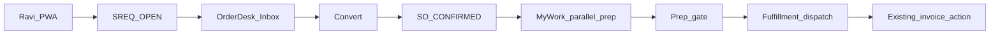

# Sankalp ERP — UI / UX now (current flow only)

**Status:** Execute this for look-and-feel + existing journeys  
**Date:** 09 August 2026  
**Related:** `docs/TRADING-JOURNEY.md`, `docs/guides/design-system.md`, `docs/guides/themes.md`, `docs/adr/0014-erp-ui-framework-classification.md`, `docs/adr/0015-trustwood-erp-platform-v1.md`, `docs/architecture/host-experience-principle.md`

**Later (do not use this file for):** `docs/SANKALP-ERP-COMPETITIVE-ROADMAP.md`, `docs/SANKALP-UI-UX-ROADMAP.md`

This document improves **what already ships**: TrustWood chrome, Dashboard, Order Desk, dealer PWA, and supporting list pages.

It does **not** add GST, AR workbench, Razorpay/UPI, WhatsApp, credit block, Tally export, warehouse admin, or any new commercial flow.

**Do not** invent a second design system. Tokens, AdminShell, `.ws-*`, Lucide, and ADR 0014 (Studio / Workspace / Form / Modal) stay.

---

## 1. Goal

Make the **current trading loop** obvious and kind:

```
Dealer PWA: browse → measured qty → cart → checkout → SREQ
  → Admin Dashboard (attention)
  → Order Desk Inbox → Convert → SO
  → My Work (parallel prep on that SO)
  → Fulfillment (dispatch / deliver)
  → existing Generate invoice / /invoices list
```

One TrustWood language. Same words on portal and Desk. No trainer required for Meena to finish a request that Ravi already placed.

---

## 2. In scope vs out of scope

### In (now)

| Area | What we change |
|------|----------------|
| Chrome | One hero / buttons / chips / empty states on existing admin screens |
| Dashboard | Attention home; save must not empty the board; CTA to Order Desk |
| Order Desk | Copy, stage hints, fewer modes for SE, confirm convert, first-run template |
| Dealer PWA | Status labels + empty/loading polish on **existing** browse → SREQ → track |
| List pages | `/customers`, `/products`, `/invoices`, `/purchase-orders`, `/analytics`, Process Studio — same look, not new features |
| Login | Clear TrustWood tenant login; stay dashboard-first after login |
| Copy | User-facing **Order Desk** only (`/oms` redirect stays) |
| A11y (light) | Focus visible on convert; contrast; no hover-only primary actions |
| Deploy | Rebuild gateway so live UI matches source |

### Out (later roadmaps)

| Do not build now | Where it lives |
|------------------|----------------|
| GST / HSN / GSTIN / IRN / QR / e-way UI | Competitive + full UX roadmaps P0.1 |
| AR workbench, ageing, allocation, credit block | P0.2 |
| Razorpay / UPI / Collect CTA | P0.3 |
| WhatsApp templates / threads | P0.4 |
| SO panel “Invoice · IRN · Collect · WhatsApp” strip | Needs P0.1–P0.4 |
| Catalog quick-add SKU, Tally export, Capacitor, WCAG AA, keyboard-first Desk | P1–P2 / full UX roadmap |

If a ticket cannot be demoed on **today’s** SREQ → SO → prep → dispatch → existing invoice, it does not belong here.

---

## 3. Current flow (as built)

Screen-by-screen journey: `docs/TRADING-JOURNEY.md`. Workflow: `oms_trading`. Customers never create SOs.



| Step | Who | Screen today | UX problem now |
|------|-----|--------------|----------------|
| 1 | Ravi | Customer shop / PDP / cart / checkout | Strong; status words may not match Desk |
| 2 | Ravi | Orders / request detail | Track works; empty/error states uneven |
| 3 | Meena | Dashboard | Save can persist empty layout; editor looks like the product |
| 4 | Meena | Order Desk Inbox | Stage rail exists; leftover “Sales Desk” in docs/copy elsewhere |
| 5 | Meena | Convert | Primary action OK; confirm sheet weak / credit not in scope |
| 6 | Priya / ops | My Work | Workbench switcher + team/mine is heavy for SE; “pricing” reads like re-price |
| 7 | Warehouse | Fulfillment | Stage rail OK; don’t merge with prep |
| 8 | Anu | Generate invoice on SO or `/invoices` | List looks like a different product (indigo/status chips); **do not** turn into AR workbench |
| 9 | Admin | Products / customers / POs | PageHeader vs ws-hero mismatch |

**Parallel prep is after Convert**, on the SO — not before. Do not “simplify” the flow by hiding prep; **explain** it.

---

## 4. Scorecard (current product only)

Overall look/feel + flow today: **~6.2**. Target after this doc only: **~7.5–8.0** (no new features).

| Surface | Now | After NOW | Notes |
|---------|----:|----------:|-------|
| Design tokens / AdminShell | 8.0 | 8.5 | Apply everywhere; don’t redesign |
| Visual consistency (admin) | 5.5 | 8.0 | One `.ws-*` language |
| Dashboard | 5.5 | 8.0 | Attention + save fix |
| Order Desk flow | 6.5 | 8.0 | Copy + SE mode; same steps |
| Dealer PWA flow | 7.5 | 8.0 | Labels + empties only |
| `/invoices` list look | 4.5 | 6.5 | Chrome only — still a list |
| Customers / products / POs | 6.0 | 7.5 | Same hero/empty pattern |
| Login / first run | 6.0 | 7.5 | Apply `oms_trading` unmissable |
| Empty / error / loading | 5.0 | 8.0 | Honest + one next click |
| User-facing copy | 5.5 | 8.5 | Order Desk everywhere in UI |

---

## 5. Framework rules (do not regress)

| Screen | Pattern | Example |
|--------|---------|---------|
| Queue + detail + tasks | **Workspace** | Order Desk |
| Multi-step authoring | **Studio** | Create product |
| Medium dedicated form | **Form + PageHeader** | Customer edit (or WorkspaceHero on list) |
| Small CRUD | **Modal** | Brand / category name |
| Commerce | **Hand-crafted** | Customer home, PDP, cart |

Anti-pattern: Studio wizard for Order Desk. Anti-pattern: Modal for Convert. Anti-pattern: Dashboard widget editor as the only way to process SREQs.

POS / delivery keep `data-theme="pos"` / `"delivery"` — not admin forest green.

---

## 6. NOW backlog by surface

### 6.1 One chrome

**Files:** `packages/ui/src/shell/admin-shell.css` (`.ws-page`, `.ws-hero`, `.ws-btn`, `.ws-chip`, `.ws-widget`, `.ws-stage`), `packages/ui/src/workspace/WorkspaceHero.tsx`, `packages/ui/src/tokens/tokens.css`, `apps/gateway` admin pages.

| ID | Work | Done when |
|----|------|-----------|
| C1 | Dashboard + Order Desk already on `WorkspaceHero` — keep as the template | Other pages copy this eyebrow / title / actions pattern |
| C2 | List pages use the same hero **or** a documented list variant of PageHeader on `--page-bg` | `/invoices`, `/customers`, `/products`, `/purchase-orders`, `/analytics`, Process Studio do not look like a third product |
| C3 | Primary / secondary actions = `.ws-btn` / `Button` only | No one-off indigo / gray CTAs |
| C4 | Status chips use design tokens (not `bg-blue-100` / `bg-green-100` one-offs) | Invoice + Desk + portal statuses feel related |
| C5 | Lucide only | No mixed icon sets on chrome |
| C6 | Mark `docs/UI-DESIGN.md` as **legacy / do not implement** in a one-line banner (optional, docs-only) | Authors don’t revive Inter/indigo |

### 6.2 Dashboard (attention, not Desk)

**Files:** `apps/gateway/src/app/(admin)/dashboard/page.tsx`, `apps/gateway/src/app/api/dashboard/config/route.ts`, `apps/gateway/src/app/api/dashboard/ops-summary/route.ts`, `packages/ui` dashboard defaults + editor.

| ID | Work | Done when |
|----|------|-----------|
| D1 | Server `registerDashboardWidgets()` on config GET/PUT; empty saved pref → role default | Save + reload still shows KPI + activity |
| D2 | PUT rejects “all unknown widget ids” | Cannot persist a blank board |
| D3 | Editor chrome behind **Customize**; default view is KPI + tables | SE does not land in widget-span UI |
| D4 | Primary CTA **Open Order Desk** (already in source — keep) | Always visible |
| D5 | Role chip on hero | Visible |
| D6 | Activity / request rows → `/sales-desk?sreqId=` or `?salesOrderId=` | No dead links |
| D7 | Empty state: **Restore default layout** + short copy | Never a blank page |
| D8 | Toast on save / reset | Feedback |
| D9 | Widget fetch error: retry control | Not only red text |

Do **not** put the Order Desk inbox on the dashboard.

### 6.3 Order Desk (same steps, clearer)

**Files:** `apps/gateway/src/app/(admin)/sales-desk/SalesDeskWorkspace.tsx`, `panels/StageRail.tsx`, `panels/InboxQueue.tsx`, `apps/gateway/src/app/(admin)/layout.tsx` (nav label already Order Desk).

| ID | Work | Done when |
|----|------|-----------|
| O1 | Hero title **Order Desk**; eyebrow **Trading operations**; link back to Dashboard | No “Sales Desk” in UI |
| O2 | Stage hints stay explicit: Inbox = sales requests · My Work = your steps · Fulfillment = in flight | SE can say what each stage is for |
| O3 | **SE / locked roles:** hide workbench switcher; show only their task queue | Admin still sees workbench + team/mine |
| O4 | Pricing task copy: **Verify dealer quote** (₹/sq ft already from portal) — not “enter price” | Priya doesn’t re-measure Agarwal’s sheet |
| O5 | Inventory task copy: **Confirm reservation** when SREQ already reserved | Matches portal behaviour |
| O6 | SREQ header: show reserved qty / measured lines if already on the payload | No new API |
| O7 | Convert confirm: customer name, total, line count (fields already on SREQ) | One explicit confirm before SO |
| O8 | First run: if no workflow, full-page **Apply OMS Trading template** | Not a small card Meena misses |
| O9 | Inbox / My Work / Fulfillment empty states: one sentence + one primary button | e.g. My Work → “Go to Inbox” |
| O10 | Deep links `?sreqId=` / `?salesOrderId=` keep working | Dashboard click-through |
| O11 | `/oms` remains redirect only | URL alias, not a second product name |
| O12 | Focus ring + non-hover Convert / Complete | Keyboard + tablet usable |

Do **not** add GST/pay/WA chips on the SO panel in this pass. Existing **Generate invoice** (if already on the SO) may get the same `.ws-btn` styling only.

### 6.4 Dealer PWA (current journey only)

**Files:** `apps/customer` — shop, PDP, cart, checkout, orders, request detail, login.

| ID | Work | Done when |
|----|------|-----------|
| P1 | Status labels match Desk: request → confirmed → dispatched → invoiced (words only; same statuses) | Ravi and Meena use the same language |
| P2 | Empty cart / empty orders / failed checkout: honest copy + Shop CTA | No blank screens |
| P3 | Skeletons on list + PDP + checkout submit | No layout jump |
| P4 | Support copy says **Order Desk / sales team** + SREQ number — not “OMS” | `profile/support` |
| P5 | Density stays `comfortable`; theme `trustwood` | Don’t copy admin `dense` |

Do **not** add pay invoice, credit limit, IRN PDF, or WhatsApp.

### 6.5 Supporting admin lists

**Files:** `apps/gateway/src/app/(admin)/invoices/page.tsx`, `customers/page.tsx`, `products/page.tsx`, `purchase-orders/page.tsx`, `analytics/page.tsx`, `configuration/page.tsx`, `workflows/page.tsx`.

| ID | Work | Done when |
|----|------|-----------|
| L1 | Invoices: ws/PageHeader chrome + token status chips; keep issue / PDF / record payment **as today** | Looks TrustWood; still a document list |
| L2 | Customers: same chrome; keep search + detail; show fields that **already exist** (name, phone, outstanding if API returns it) | No credit-block UX |
| L3 | Products list: same chrome; Studio create unchanged | No quick-add wizard |
| L4 | POs / analytics / Process Studio: same page background + hero/header | One admin family |
| L5 | Lead-to-cash explainer blocks on invoices: restyle or tuck under “How this works” so they don’t dominate | Desk remains the operational home |

### 6.6 Login / first run

| ID | Work | Done when |
|----|------|-----------|
| F1 | Tenant login: slug + password/OTP on TrustWood; error text readable | Demo users can sign in |
| F2 | After login → Dashboard (already locked) | Not Order Desk as default home |
| F3 | No `oms_trading` → Order Desk full-page apply (O8) | First tenant hour is survivable |

### 6.7 Copy (user-facing)

| Use in UI | Do not use in UI |
|-----------|------------------|
| Order Desk | Sales Desk, OMS (except `/oms` URL) |
| Sales request / SREQ | “Order” before convert |
| Sales order / SO | |
| Inbox | “Open orders” for SREQs |
| My Work | “Fulfilment tasks” for prep |
| Fulfillment | Prep / pricing |
| Verify quote | Enter / set price (when dealer already quoted) |
| Generate invoice | Collect / GST / IRN (not built yet) |

Internal ADRs and `apps/sales` may still say Sales Desk. User chrome must not.

### 6.8 Deploy

| ID | Work | Done when |
|----|------|-----------|
| X1 | `docker compose up -d --build --no-deps gateway` (or host equivalent) after chrome + dashboard save land | Live :443 admin matches this doc |
| X2 | Smoke: login → Dashboard widgets visible after Customize save → Open Order Desk → Inbox → Convert → My Work → Fulfillment | Current flow only |

---

## 7. Suggested implementation order

1. **D1–D2, D7–D8** — dashboard save/empty (demo blocker).  
2. **C1–C4, O1–O2, O9** — one chrome + Desk stage copy.  
3. **O3–O8, O12** — SE mode, task copy, convert confirm, first-run template.  
4. **D3–D6, D9** — dashboard as attention home.  
5. **L1–L5** — invoices / customers / products / POs / analytics chrome.  
6. **P1–P5, F1–F3** — portal labels + login.  
7. **X1–X2** — rebuild + smoke the current Agarwal path.

---

## 8. Acceptance — Agarwal Ply (current flow)

No new money/tax/messaging features. Success is **clarity**:

1. Ravi: PDP size × rate = line total → checkout → **SREQ-#####**.  
2. Meena: Dashboard shows attention → **Open Order Desk** → Inbox → SREQ → Convert confirm (customer + total) → **SO-#####**.  
3. Priya: My Work task reads **Verify dealer quote**, not a blank price form.  
4. Warehouse: Fulfillment stage only — dispatch/deliver as today.  
5. Anu: existing Generate invoice / `/invoices` list — same visual language, same actions as today.  
6. Save Dashboard layout → reload → widgets still there.

---

## 9. Document control

| Item | Value |
|------|--------|
| This file | Current UI + current flow only |
| Full product 10/10 | `docs/SANKALP-ERP-COMPETITIVE-ROADMAP.md` |
| Full UX including GST/AR/pay/WA | `docs/SANKALP-UI-UX-ROADMAP.md` |
| Screen map | `docs/TRADING-JOURNEY.md` (still says Sales Desk in places — UI copy follows **this** file) |
| Next **product** engineering | Still P0.1 GST when scheduled — not this doc |
| Next **UI** engineering | This backlog |
