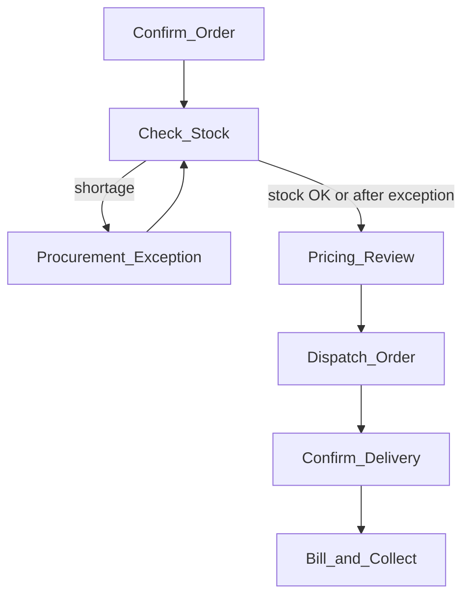

# SO Task Rationalization — Activity vs Business Work Item

**Status:** Phase 0 **LOCKED** (2026-08-15) · Bill & Collect capture model clarified 2026-08-15  
**Template evidence:** `SO_STANDARD` v9 — starter form **rev 5** — [`packages/workflow/src/templates/so-standard-v5.ts`](../packages/workflow/src/templates/so-standard-v5.ts)  
**Companion:** [`WORKFLOW-PLATFORM.md`](WORKFLOW-PLATFORM.md) · backlog **BL-035** / **BL-036**

This document is the **single decision artifact** for human-facing Sales Order work.  
Engine activities stay; Order Desk must not expose 1:1 activity = task.

---

## 1. Principles (locked)

### Layers

```text
SO_STANDARD Activity
        │
        ▼
KEEP / MERGE / CONDITIONAL / AUTOMATIC
        │
        ▼
Business Work Item
        │
        ▼
Operator experience (Order Desk)
```

| Layer | Responsibility |
|-------|----------------|
| Workflow Activity | Routing, RBAC, audit, optional/auto, projection |
| Workflow Engine | Snapshot + AND readiness (`deps.every`) |
| Business Work Item | Human unit of work (0..n activities) |
| Order Desk | Queues and forms for Work Items only |

### Work Item ≠ one engine completion

A composite Work Item may advance **several** engine activities behind one operator **Complete**, preserving granular audit. Coordination mechanism is **out of Phase 0** (see BL-035).

### Do not delete engine activities

Keep activities unless a later plan has a strong reason to collapse nodes. Retention preserves audit, RBAC, history, conditions, reporting, flexibility.

### Role boundaries decide MERGE (not task similarity)

Merge only when **same person, same queue, same SLA, same objective, compatible timing/accountability**.  
Otherwise **KEEP** separate Work Items even if sequential.

### Joins

- **AND** at engine: already shipped.  
- **OR** join: out of scope.  
- Procurement: **CONDITIONAL** exception (optional + `shortage`), not a peer step on every order.

---

## 2. Validation records

### Pricing — **KEEP** (locked)

| Question | Evidence (template RBAC) | Answer |
|----------|--------------------------|--------|
| Different person? | `roleHint: PRICING_EXECUTIVE`; claim/complete only that role (+ manager/admin reassign) | **Yes** |
| Own queue / SLA? | Separate Order Desk persona **Pricing**; distinct from Sales / Dispatch | **Yes** |
| Can Sales change pricing themselves? | Sales cannot claim `PRICING_REVIEW` without ADMIN override | **No** (by design) |

**Decision:** **KEEP** Pricing Review as its own Business Work Item.  
Do **not** MERGE into Prepare Fulfilment / Check Stock while `PRICING_EXECUTIVE` is a distinct queue.

*If a tenant later assigns the same human both Sales and Pricing hats, they may still use one login with two personas; the Work Item stays separate for accountability.*

### Invoice vs Payment — **MERGE** into Bill & Collect (locked)

| Question | Evidence | Answer |
|----------|----------|--------|
| Same person / role? | Both `roleHint: ACCOUNTANT` | **Yes** |
| Same queue? | Finance workbench | **Yes** |
| Payment later? | Yes — payment may lag invoice; Work Item can remain open / resume | Allowed |
| Separate collection queue needed? | Not in current OMS desk; AR ageing is separate product (BL-011+) | **Not now** |

**Decision:** **MERGE** `invoice` + `payment` → **Bill & Collect**.  
Engine still runs `INVOICE_GENERATE` then `PAYMENT_COLLECTION` (audit + `INVOICED` / `PAID` projections). Operator sees one Work Item that may span time after invoice until paid.

*Re-open only if Trustwood requires a dedicated collections queue with different SLA/owner from invoicing.*

### Warehouse vs Dispatch — **MERGE** warehouse into Dispatch Order (locked)

| Question | Evidence | Answer |
|----------|----------|--------|
| Same person / role? | Both `DISPATCH_EXECUTIVE` | **Yes** |
| Same queue? | Warehouse / Dispatch workbench | **Yes** |
| Same objective? | Get goods out the door | **Yes** |

**Decision:** `warehouse` + `dispatch` → **Dispatch Order** (composite).  
Engine keeps `WAREHOUSE_PICK` then `DISPATCH`.

### Inventory vs Pricing vs Warehouse — **not** one three-way MERGE (locked)

| Activity | Role today |
|----------|------------|
| `inventory` | `SALES_EXECUTIVE` |
| `pricing` | `PRICING_EXECUTIVE` |
| `warehouse` | `DISPATCH_EXECUTIVE` |

Three different queues → **cannot** honestly MERGE into a single single-owner Prepare Fulfilment Work Item under the role-boundary rule.  
**Check Stock** (inventory) stays Sales-owned; Pricing KEEP; Warehouse merges with Dispatch.

---

## 3. Activity matrix

| Activity | Type | Kind | Role today | Business objective | Human decision? | Inputs | Output / projection | Always? | Exception? | Class | Maps to Work Item |
|----------|------|------|------------|--------------------|-----------------|--------|---------------------|---------|------------|-------|-------------------|
| `sales_review` | `SALES_REVIEW` | HUMAN | SALES_EXECUTIVE | Confirm lines, customer, promise | Yes — accept/amend order | Cart/SREQ lines, customer, notes | `CONFIRMED` | Yes | No | **KEEP** | **Confirm Order** |
| `inventory` | `INVENTORY_CHECK` | HUMAN | SALES_EXECUTIVE | Confirm availability; set shortage | Yes — stock ok / shortage | Lines, godown availability | `FULFILLING`; may set `shortage` | Yes | No | **KEEP** | **Check Stock** |
| `procurement` | `PROCUREMENT_REQUEST` | HUMAN | SALES_EXECUTIVE | Raise indent when short | Yes — vendor indent | Shortage lines | PO/indent path; then continue | No | **Yes** (`optional` + `shortage`) | **CONDITIONAL** | **Procurement Exception** |
| `pricing` | `PRICING_REVIEW` | HUMAN | PRICING_EXECUTIVE | Landed cost / dealer sell / margin | Yes — price authority | Lines, costs | Prices on SO; `FULFILLING` | Yes | No | **KEEP** | **Pricing Review** |
| `warehouse` | `WAREHOUSE_PICK` | HUMAN | DISPATCH_EXECUTIVE | Select godown / pick ready | Yes — warehouse choice | Lines, warehouse | `warehouseId`; `READY_FOR_DISPATCH` | Yes | No | **MERGE** | **Dispatch Order** |
| `dispatch` | `DISPATCH` | HUMAN | DISPATCH_EXECUTIVE | Hand off to fleet / Porter | Yes — mode, vehicle, tracking | Warehouse done | `DISPATCHED` | Yes | No | **KEEP** (composite host) | **Dispatch Order** |
| `deliver` | `DELIVERY_CONFIRM` | HUMAN | DELIVERY_EXECUTIVE | Confirm POD / delivered | Yes — confirm delivery | Dispatch info, POD | `DELIVERED` | Yes | No | **KEEP** | **Confirm Delivery** |
| `invoice` | `INVOICE_GENERATE` | HUMAN | ACCOUNTANT | Tax invoice + final billed qty/price | Yes — generate/issue; may edit lines | Delivered SO | Invoice; `INVOICED` | Yes | No | **MERGE** | **Bill & Collect** |
| `payment` | `PAYMENT_COLLECTION` | HUMAN | ACCOUNTANT | Record advance / full collection | Yes — amount/method/UTR | Open invoice | Payment; `PARTIAL`/`PAID` | Yes | No | **MERGE** | **Bill & Collect** |
| `close` | `ORDER_CLOSE` | SYSTEM | — | Close order | No (autoComplete) | Prior terminal | `CLOSED` | Yes | No | **AUTOMATIC** | **SYSTEM** (hidden) |

---

## 4. Locked Activity → Work Item map

**Locked:** 2026-08-15  
**Basis:** Template RBAC + role-boundary rule (Section 2).

```text
sales_review ────────────────→ Confirm Order

inventory ───────────────────→ Check Stock

procurement ─────────────────→ Procurement Exception   (CONDITIONAL)

pricing ─────────────────────→ Pricing Review

warehouse ───────┐
dispatch ────────┴───────────→ Dispatch Order

deliver ─────────────────────→ Confirm Delivery

invoice ─────────┐
payment ─────────┴───────────→ Bill & Collect

close ───────────────────────→ SYSTEM
```

### Operator journey (normal path)



### Order Desk sketch (Work Items only)

```text
SO-….. · Customer
● Confirm Order           READY
○ Check Stock             WAITING
○ Pricing Review          WAITING
○ Dispatch Order          WAITING
○ Confirm Delivery        WAITING
○ Bill & Collect          WAITING
```

Procurement Exception appears **only** when `shortage` requires human intervention (engine already SKIPPED when false).

---

## 5. Engine activities retained

All ten nodes remain in `SO_STANDARD`. Classification **MERGE** / **CONDITIONAL** changes **presentation and completion UX**, not graph deletion.

| Work Item | Engine activities advanced (future BL-035) |
|-----------|--------------------------------------------|
| Confirm Order | `sales_review` |
| Check Stock | `inventory` (+ may set shortage → unlock procurement) |
| Procurement Exception | `procurement` |
| Pricing Review | `pricing` |
| Dispatch Order | `warehouse` then `dispatch` (one Complete may chain both) |
| Confirm Delivery | `deliver` |
| Bill & Collect | `invoice` then `payment` (may be two sessions; one Work Item) |
| SYSTEM | `close` auto |

---

## 6. Explicitly out of Phase 0

- New OMS widgets  
- OR-join engine feature  
- Form redesign / composite form layouts  
- Order Desk Work Item UI implementation  
- Deleting or collapsing workflow nodes  

---

## 7. BL-035 Work Items

Order Desk Work Item queues + composite complete landed (IN_PROGRESS until E2E labels asserted). Engine activities retained.

## 8. Order context (BL-036)

| Concept | Owner | Storage | Desk / forms |
|---------|-------|---------|--------------|
| OrderNote | Sales | `erp_sales.OrderNote` | Notes widget (Phase 2) + API hydrate |
| OrderDocument | Sales | `erp_sales.OrderDocument` | Attachments widget; finalize on complete |
| Customer | Sales | `Customer` | CustomerInfo widget + host chrome |
| Messages | Gateway | `Conversation` / `Message` | Host chrome only — not form layout |
| Buyer checkout note | Sales | `SalesRequest.notes` → SO `notes` + `OrderNote` (source `customer-checkout`) on convert | Portal FormField (not desk Notes widget) |
| Buyer checkout files | Sales | `SalesRequestDocument` → `OrderDocument` on convert | Portal host upload + link API (not desk Attachments widget) |

Starter **rev 5** ships Bill & Collect invoice UX (editable lines + InvoiceGenerate + optional advance). Rev 4 chrome (`CustomerInfo` → domain → `Notes` → `Attachments`) remains the baseline for other HUMAN forms. Host `applyHostLayoutChrome` remaps pinned older layouts.

---

## 9. Task field matrix (completion gates)

Required vs optional fields when completing each SO_STANDARD activity.  
**Warehouse ≠ dispatch** — pick-&-pack never asks for vehicle; own-fleet vehicle/driver and Porter booking are enforced only on **dispatch** (`canCompleteDispatch`).  
**Product / price / advance ≠ Confirm Order** — final billed lines and cash are captured on **Bill & Collect** only (§9.1).

| Activity / form | Required to complete | Optional | Notes |
|-----------------|---------------------|----------|-------|
| **sales_review** | ≥1 line item | remarks, deliveryDate | Commercial confirm — not tax invoice / not cash |
| **inventory** | `availableQty` per line | remarks | Shortage opens procurement |
| **procurement** | — | notes, attachments | Conditional |
| **pricing** | purchase/landed cost per line (as form requires) | | Authority for trade margin before fulfil |
| **warehouse** | — | `warehouseId`, notes, attachments | Pick & pack only — **no vehicle** |
| **dispatch** (own fleet) | `vehicleInfo`, `assignedDriverId` | tracking | Via `DispatchFulfillment` + DriverPicker |
| **dispatch** (Porter) | `porterBookingStatus` in `BOOKING_PENDING` \| `BOOKED` | trackingNumber/Url | ExternalLink opens Porter; opening link does **not** complete |
| **delivery** | — | POD attachments, notes | |
| **invoice** | Generate + confirm (`InvoiceGenerate`) | qty / unit price, advance fields | See §9.1 |
| **payment** | — (optional to leave open) | `paymentAmount`, method, UTR | Same Work Item; see §9.1 |

### 9.1 Bill & Collect — products, prices, advance (locked capture model)

**Work Item:** `bill_and_collect` · **Role:** `ACCOUNTANT` · **Engine:** `invoice` → `payment`

One finance queue. Operator never gets a separate “Collect advance” task. Money always lands on the **Accounting invoice** linked by `sourceRef = SalesOrder.id`.

#### What is captured where

| Detail | Captured on | Persists to | When |
|--------|-------------|-------------|------|
| Customer (read-only chrome) | Invoice / payment forms (`CustomerInfo`) | already on SO / Customer | display only |
| **Updated product qty** | Bill & Collect · invoice form (`ProductList` editable) | `SalesOrderItem.quantity` (+ totals) | Before **Generate** (`PUT …/invoice-lines`) and again on invoice complete |
| **Updated unit price** | Same (`ProductList` + `showPrice`) | `SalesOrderItem.unitPrice` / `total` | Same as qty — Accountant may correct billed price |
| Line remove / add catalog | **Not** on invoice (`allowRemove: false`) | — | Adds/removes stay on **Confirm Order** / earlier steps |
| Tax invoice PDF | `InvoiceGenerate` → Accounting `generateInvoice` | `Invoice` + lines + `pdfUrl` | Generate / Regenerate / Download |
| Invoice number / id | Host hydrate + generate response | fieldValues + documents | After generate |
| Notes / attachments | Notes + Attachments widgets | OrderNote / OrderDocument | Any Bill & Collect session |
| **Advance / partial payment** | Optional fields on **invoice** form **or** payment form | Accounting `Payment` on that invoice; SO `paymentStatus` | Same session as issue **or** later reopen |
| Full settlement | Payment amount ≥ remaining | Invoice `PAID`; SO `PAID` | Completes payment activity |
| Send PDF to customer | **Out of scope now** | notifications later | Not an OMS task field |

#### Linkage (must stay true)

```text
SalesOrder (lines qty/price)
    │
    ├── invoice-source ──► Accounting.generateInvoice
    │                         │
    │                         ▼
    │                      Invoice (ISSUED)
    │                         │
    │                         ├── Payment (advance) → PARTIALLY_PAID · SO PARTIAL
    │                         └── Payment (full)    → PAID · SO PAID
    │
    └── Bill & Collect Work Item stays open until payment activity completes
        (or remaining is collected later via same WI / AR)
```

#### Operator sequence (happy path)

1. Open **Bill & Collect** after Confirm Delivery.  
2. **Review / update** qty and unit price if billed amounts differ from prep.  
3. **Generate invoice PDF** → **Download** (review GST invoice).  
4. Optionally enter **Advance / amount collected**, method, UTR.  
5. **Confirm & complete** → completes `invoice`; if payment fields present, also records payment and may complete `payment`.  
6. If no cash yet: omit payment fields → invoice only; reopen Bill & Collect later for collection.  
7. If advance only: SO `PARTIAL`, invoice `PARTIALLY_PAID`; remaining on AR / same Work Item.

#### Anti-patterns (locked out)

| Do not | Why |
|--------|-----|
| Capture advance on Confirm Order / Pricing / Dispatch | Wrong role; no tax invoice to allocate against |
| Split “Issue invoice” and “Collect” into two Work Items | Breaks MERGE; Accountant is one queue |
| Mark SO `PAID` on advance | Use `PARTIAL` until invoice fully paid |
| Unallocated cash without invoice | Breaks GST / AR; always issue invoice first on this path |

### 9.2 Dispatch Order Work Item (MERGE)

`dispatch_order` merges **warehouse** + **dispatch**. Composite complete is **sequential**:

1. Warehouse-only payload → completes warehouse; Work Item stays actionable with primary = dispatch.
2. Dispatch completes in the same or a later session only when fulfillment evidence is present (own-fleet vehicle+driver **or** Porter status ready).

Do **not** un-merge into two Work Items; keep MERGE locked.
